# OpsPilot

OpsPilot is an approval-gated AI incident-to-fix control plane. It connects a GitHub repository and production log source, builds evidence from a pinned commit, diagnoses an incident, verifies a bounded patch in an isolated runner, and opens a **draft** FIX pull request only after an authorized human approves the exact diff.

It is deliberately not an autonomous production operator: it cannot merge a PR, push to the default branch, deploy, roll back, or run an arbitrary model-generated shell command.

## What works

- Clerk authentication, workspace RBAC, project limits, usage accounting, and auditable project deletion.
- One-time GitHub App installation sessions; repository selection is revalidated server-side.
- Durable NATS/JetStream repository ingestion with database recovery, filtering, redaction, chunking, local or Gemini embeddings, and hybrid cited retrieval.
- Manual, Vercel, and Railway build/runtime log collection. Provider tokens are AES-256-GCM encrypted and never returned to the browser.
- Redacted, evidence-backed RCA with durable incident/workflow/step history and explicit insufficient-context states.
- Pinned fix proposals with file/path/size/secret policy checks and baseline-versus-patched sandbox verification.
- Expiring approval records whose payload hash binds the reviewed diff, base commit, and intended action.
- GitHub draft PR publication on a new `opspilot/fix-*` branch after approval; base SHA and original file hashes are checked again immediately before writing.
- Deployment-readiness scan plus deterministic Dockerfile, Compose, and names-only `.env.example` drafts for Node/Next.js, Python, and Go.
- Configurable 1–365 day stored-log retention (30 days by default), low-cardinality Prometheus metrics, JSON logs, correlation IDs, health/readiness checks, CORS allowlists, and rate limiting.

## Orchestration

```mermaid
flowchart LR
  A["Vercel / Railway / manual logs"] --> B["Bounded collection + normalization"]
  B --> C["Secret redaction + fingerprint"]
  C --> D["Durable incident workflow"]
  D --> E["Pinned repository retrieval"]
  E --> F["Evidence-backed RCA"]
  F --> G["Bounded fix proposal"]
  G --> H["Policy + secret scan"]
  H --> I["Baseline and patched sandbox tests"]
  I --> J["Exact diff + expiring approval"]
  J -->|approved| K["Revalidate SHA and file hashes"]
  K --> L["New branch + draft FIX PR"]
  J -->|rejected / expired| M["Stop and audit"]
```



The LLM proposes analysis and code. Deterministic services own identity, authorization, state transitions, limits, encryption, tool execution, approval validation, and GitHub writes. See [Architecture and threat model](docs/ARCHITECTURE.md) for tool contracts and failure modes.

## Architecture

| Component | Responsibility |
| --- | --- |
| Next.js frontend | Operations cockpit, evidence, usage, readiness, diff review, approvals |
| Go API gateway | Clerk auth boundary, tenant checks, routing, rate/CORS/security policy, request correlation |
| Go auth/workspace/project services | Identity mapping, RBAC, lifecycle controls, project limits |
| Go integration service | GitHub App, encrypted Vercel/Railway credentials, log adapters, approval execution, draft PR writer |
| Python AI worker | Ingestion, embeddings, RAG, RCA, fix proposal, usage enforcement, retention cleanup |
| Sandbox runner | Narrow internal verification API backed by hardened ephemeral Docker containers |
| PostgreSQL + pgvector | Tenant-scoped durable state, vectors, workflows, approvals, audits, usage |
| NATS JetStream | Durable ingestion wakeups; database polling is the recovery path |

## Quick start

Requirements: Docker Desktop, Go 1.22+, Node.js 22+, Python 3.12+, and a Clerk application.

```bash
cp .env.example .env
openssl rand -base64 32   # CREDENTIAL_ENCRYPTION_KEY
openssl rand -hex 32      # AI_WORKER_INTERNAL_TOKEN
openssl rand -hex 32      # SANDBOX_RUNNER_INTERNAL_TOKEN
```

Fill the Clerk and GitHub App values, then:

```bash
docker compose up --build -d
make migrate
make health
```

Open [http://localhost:3000](http://localhost:3000). The sandbox runner requires a working Docker daemon and is intentionally not published to the host.

For frontend hot reload during development, stop the Compose frontend and run `cd frontend && npm ci && npm run dev`.

Detailed setup and production checks are in [Operations](docs/OPERATIONS.md) and [GitHub App setup](docs/github-app-setup.md).

## Verification

```bash
make test

cd frontend
npm test
npm run lint
npm run build

cd ..
AI_WORKER_INTERNAL_TOKEN=test-only \
SANDBOX_RUNNER_INTERNAL_TOKEN=test-only \
CLERK_SECRET_KEY=test-only \
docker compose config --quiet
```

CI also applies every migration to PostgreSQL/pgvector, verifies generated protobufs, and builds every backend and frontend image. A live end-to-end run additionally needs real Clerk, GitHub App, AI-provider, and log-provider credentials.

## Security invariants

- Repository/log/webhook text is data, never trusted instruction.
- Every tenant identifier is reauthorized at the service that owns the resource.
- The model has no generic shell, HTTP, database, merge, deploy, or secret-reading tool.
- External writes require an expiring, single-use approval over a canonical payload hash.
- Fixes are limited to safe text paths; `.github/workflows`, secrets, keys, binaries, generated/vendor paths, and oversized changes are blocked.
- Verification source runs with no network, non-root UID, read-only container root, dropped capabilities, bounded CPU/memory/PIDs/time/output.
- Dependency installation sees manifests/lockfiles only; repository source is mounted after egress is disabled.
- The default branch is never modified. The only repository write is a new branch and draft pull request.
- The Docker socket is mounted only into the internal runner; treat that runner as a privileged security boundary.

## Product direction

[Product analysis](docs/PRODUCT_ANALYSIS.md) compares OpsPilot with Sentry Seer, Resolve AI, Rootly AI SRE, Datadog Bits AI, incident.io Investigations, and GitHub coding agents. The highest-value next additions are alert-triggered investigations, an evidence graph with parallel hypotheses, richer telemetry adapters, incident feedback/evaluation, and a bounded CI-feedback loop on existing draft PRs.

## Current limits

- GitHub is the only source-control provider; one primary repository is supported per project.
- Vercel and Railway are the only production-log adapters.
- The local embedding provider is deterministic and private but lower quality than Gemini.
- Sandbox verification recognizes npm lint/build/test, pytest, and Go tests. No recognized tests means the fix is not considered verified.
- OpsPilot creates draft PRs only. Merge, deploy, rollback, infrastructure mutation, and arbitrary remediation are outside this release.
- Compose is a development/single-host topology. A production deployment still needs managed PostgreSQL, backups, TLS/ingress, secret management, private service networking, image scanning, and distributed rate limiting.
