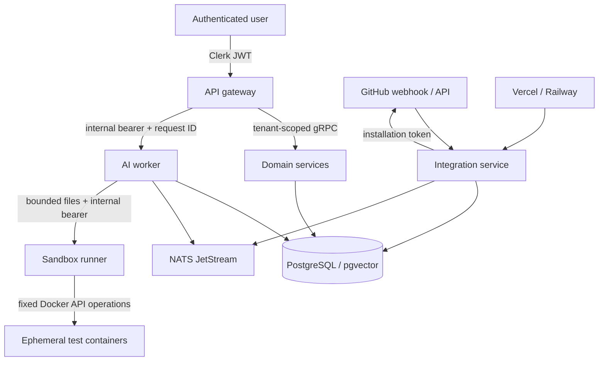
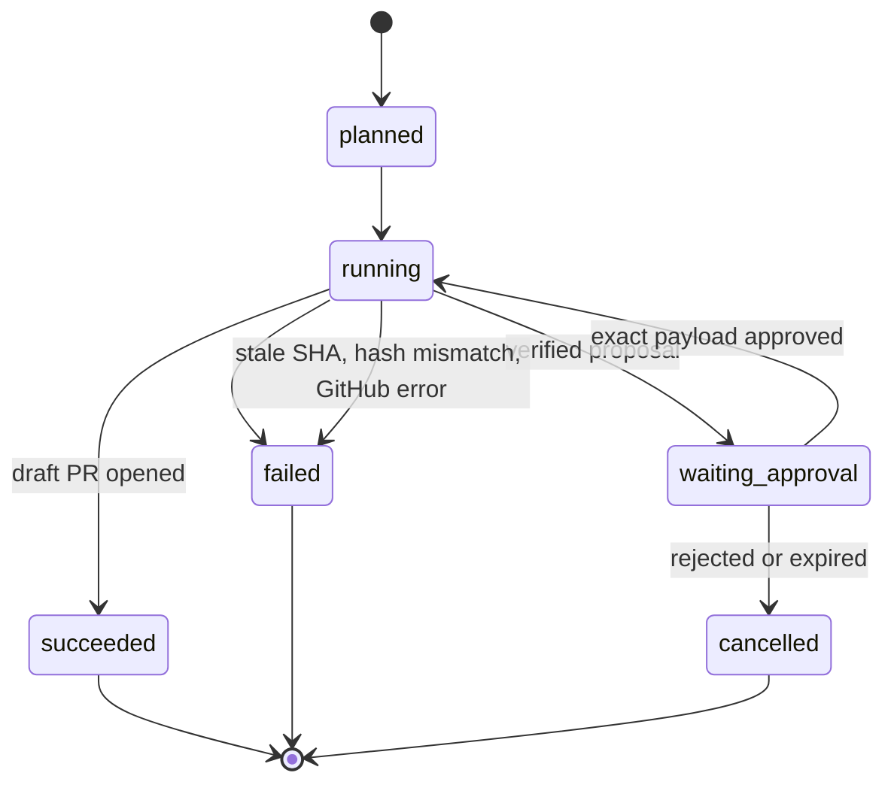

# Agent harness architecture and threat model

## Design decision

OpsPilot uses one model-driven reasoning loop inside a deterministic workflow engine. It does not give several autonomous agents overlapping credentials and ask them to coordinate by conversation. Separate “triage”, “RCA”, “patch”, and “review” roles can be added as model calls, but they exchange typed artifacts through the workflow store and have no independent authority.

This keeps the useful specialization of multi-agent systems without multiplying confused-deputy, prompt-injection, race, cost, and audit problems. OWASP calls out excessive functionality, permissions, and autonomy as the root causes of excessive agency and recommends narrow tools, least privilege, downstream authorization, complete mediation, and human approval for high-impact actions: <https://genai.owasp.org/llmrisk/llm062025-excessive-agency/>.

## Trust boundaries

| Boundary | Trusted for | Never trusted for |
| --- | --- | --- |
| Browser/JWT | Presenting a signed Clerk session | Workspace/project/role claims in request bodies |
| GitHub webhook | Delivery only after HMAC verification | Instructions inside commit messages, issues, code, or diffs |
| Repository and logs | Evidence bytes | Commands, policy, authorization, or tool selection |
| Model output | Candidate analysis and candidate patch | SQL, shell, URLs, approval, scope, or write authorization |
| Sandbox result | Exit status for a fixed test plan | Proof of semantic correctness or permission to publish |
| Human approval | Consent to one canonical action | Consent to later/recomputed payloads |

## Workflow state machine

Each run has a durable `workflows` row and ordered `workflow_steps`. Allowed terminal states are explicit; service code, not the model, moves them.

The incident-to-fix workflow is:

1. Authorize the user against the workspace and project.
2. Collect at most the configured number of provider log records, or accept at most 1 MiB of pasted logs.
3. Normalize and redact secret-like values before persistence and before any model call.
4. Fingerprint the failure and create the log, workflow, ordered steps, and incident in one transaction.
5. Retrieve tenant-filtered chunks from the currently indexed commit using vector and keyword evidence.
6. Produce structured RCA: title, summary, root cause, recommendation, confidence, assumptions, and citations. Low retrieval support becomes `insufficient`, not a confident guess.
7. Fetch the repository again and require it to match the indexed commit.
8. Generate a structured, bounded set of text-file replacements. Parse and validate it as data.
9. Block secret-bearing repositories, forbidden paths, duplicate paths, missing original files, oversized files/diffs, or suspicious generated content.
10. Run detected baseline checks, then the same checks against the patched source. A baseline failure is recorded; a patched failure/timeout/no-tests result cannot become a verified proposal.
11. Persist the exact unified diff, file hashes, base SHA, verification output, canonical action payload, SHA-256 payload hash, expiry, and pending approval.
12. On approval, atomically claim the approval so it cannot be replayed. Recompute the payload hash and reauthorize the approver.
13. Fetch the current base ref and original files again. Abort on SHA/hash drift.
14. Create blobs, a tree, a commit, a new `opspilot/fix-*` ref, and a draft PR. Never update the base ref.
15. Store the sanitized tool result and PR URL, complete the workflow, and expose it in incident history.

## Required tool contracts

Tools are ordinary deterministic service methods with strict schemas. The model never receives a generic `execute`, `fetch`, or database tool.

### Read tools

| Tool | Inputs | Output/limits | Authorization |
| --- | --- | --- | --- |
| `repository_snapshot` | workspace, project | Safe text files at an exact SHA; 3,000 files, 30 MiB total, 512 KiB/file | Active GitHub installation + project membership |
| `retrieve_code` | workspace, project, query, top-k | At most 20 chunks with path, lines, score, citation | Tenant predicates in SQL |
| `collect_provider_logs` | workspace, project, connection, kind, limit | Normalized bounded text; raw provider error bodies discarded | Membership + encrypted workspace credential |
| `incident_history` | workspace, project, limit | Sanitized workflows, steps, diffs, approvals, PR result | Project membership; proposed full file content omitted |
| `deployment_scan` | workspace, project | Deterministic findings from pinned source | Project membership + usage entitlement |

### Candidate-generation tools

| Tool | Inputs | Output/limits | Side effect |
| --- | --- | --- | --- |
| `analyze_incident` | redacted logs + retrieved evidence | Schema-validated RCA with citations | Creates incident/workflow records only |
| `propose_fix` | incident + pinned files | Existing-file text replacements only | Creates pending proposal/approval only |
| `generate_deployment_files` | pinned files | Dockerfile, Compose, names-only env template | Returns drafts; no repository/provider write |

### Execution tools

| Tool | Preconditions | Permitted action | Explicitly forbidden |
| --- | --- | --- | --- |
| `sandbox_verify` | policy-clean bounded files | Install from manifests, then execute detected tests in isolated containers | Model shell, host mounts, source-network access, secrets |
| `publish_draft_fix_pr` | claimed unexpired approval, matching hash/SHA/file hashes, owner/admin | New branch, commit, draft PR | Default-branch update, force-push, merge, workflow-file edit |

Every execution call has a risk level, idempotency key, request summary, response summary, status, timestamps, workflow ID, and approval ID in `tool_calls`.

## Guardrail layers

### 1. Identity and tenancy

- Clerk JWT validation happens at the gateway, but internal user identity is resolved through Auth Service.
- Workspace/project ownership is checked again by the domain service before data access.
- SQL retrieval and writes include both workspace and project IDs.
- Owner/admin is required for project creation/deletion, retention changes, provider credential writes, and FIX PR approval.
- Unknown plans fail closed to free-plan limits; counters are serialized with PostgreSQL advisory/row locks.

### 2. Input and prompt-injection containment

- Webhooks are HMAC-verified; payload prose cannot select tools.
- Logs and source are delimited as untrusted evidence and scanned/redacted before model use.
- `.env`, keys, certificates, VCS internals, dependencies, binaries, and build output are excluded from ingestion and sandbox input.
- Model output must parse into a fixed schema and then pass independent policy. Natural-language claims such as “tests pass” have no effect.
- No model-selected URL fetching. Provider/GitHub hosts and API paths are adapter-controlled.

OWASP’s AI Agent Security guidance treats direct/indirect prompt injection, tool abuse, data exfiltration, memory poisoning, and denial-of-wallet as first-class agent risks: <https://cheatsheetseries.owasp.org/cheatsheets/AI_Agent_Security_Cheat_Sheet.html>.

### 3. Secrets

- Provider credentials are write-only AES-256-GCM envelopes with random nonces, versioned AAD, and a 32-byte external key.
- GitHub installation tokens are short-lived and never persisted.
- GitHub install `state` is 32 random bytes; only its SHA-256 hash is stored, for 10 minutes, single use.
- Raw provider error responses and authorization headers are never logged or returned.
- Redaction occurs before log persistence/model use; secret-like repository values block sandbox/fix generation.
- Production secrets belong in a secret manager, not Compose environment files.

### 4. Repository writes

- Use a GitHub App installed on selected repositories. GitHub recommends selecting only the minimum permissions: <https://docs.github.com/en/apps/creating-github-apps/registering-a-github-app/choosing-permissions-for-a-github-app>.
- Read/write `Contents` and `Pull requests` are needed for this release. `Workflows`, `Administration`, `Actions`, `Secrets`, `Deployments`, and `Issues` are not requested.
- Approval is bound to the exact action payload; it expires and is atomically claimed once.
- Base SHA and each changed file hash are checked twice: at proposal and at publication.
- The PR stays draft and branch protections remain authoritative.

### 5. Code execution

- The runner API is private and token-authenticated; only the AI worker can call it.
- File count, path, size, total bytes, output, duration, CPU, memory, swap, and PID count are bounded.
- Dependency resolution runs before source is mounted and uses `--ignore-scripts` for npm.
- Test containers use non-root UID, read-only root filesystem, dropped capabilities, `no-new-privileges`, tmpfs, and `--network none`.
- The Docker socket grants host-equivalent authority. Run the runner on a dedicated worker/VM in production, with no platform secrets and disposable capacity. Never colocate it with the database or control-plane credentials.

### 6. Reliability and cost

- JetStream durable pull subscriptions wake ingestion; queued DB rows recover missed/unavailable messages.
- Jobs have attempt counters, maximum attempts, and dead-letter state.
- Each model/action class has atomic monthly usage limits; repository storage has a live byte cap.
- API body/response limits and per-token/IP rate limits prevent unbounded calls.
- Workflows, steps, approvals, tool calls, usage events, and audits make retries observable.
- Correlation IDs are accepted only from a bounded safe alphabet and propagated gateway-to-worker.

### 7. Observability and lifecycle

- `/health` is liveness; AI `/ready` checks PostgreSQL and the sandbox runner/Docker daemon.
- `/metrics` on gateway and AI worker exposes only method/status labels, avoiding tenant-ID cardinality and leakage.
- Go and AI logs are structured JSON in normal service execution; tokens and raw log bodies are not fields.
- Workspace log bodies expire after 30 days by default (configurable 1–365); incident summaries and audits remain.
- Project deletion is owner/admin-only, typed-confirmed in the UI, audited, and cascades project data.

## Why approval is a protocol, not a button

The approval record includes `action_type`, canonical JSON payload, payload hash, requester, risk, expiry, status, approver, and timestamps. Publication succeeds only when the stored proposal reconstructs the same hash. This prevents a UI race where a person reviews one diff and the agent executes another.

GitHub’s own cloud-agent controls similarly constrain agents to a branch, keep PRs draft, require human review, honor branch protection, and restrict workflow execution: <https://docs.github.com/en/copilot/concepts/agents/cloud-agent/risks-and-mitigations>.

## Failure behavior

| Failure | Result |
| --- | --- |
| Provider timeout/invalid token | Generic collection failure; provider response body hidden |
| Weak/no code evidence | Incident saved with insufficient confidence; no invented citation |
| Repository moved since indexing | Readiness/fix stops and asks for re-indexing |
| Baseline tests fail | Recorded as pre-existing; patched run still must pass to verify |
| Patched tests fail/timeout/no tests | No publishable verified proposal |
| Secret/forbidden path/oversized diff | Proposal rejected before approval |
| Approval rejected/expired/replayed | No GitHub write; terminal audited state |
| Base/file drift after approval | Publication aborts; new analysis/review required |
| NATS unavailable | DB recovery worker continues ingestion |
| Sandbox/Docker unavailable | AI readiness degrades; fix generation fails closed |
| GitHub partial write after branch creation | Tool call fails visibly; base branch remains unchanged; orphan branch can be deleted manually |

## Safe extension pattern

To add a provider or action:

1. Define a typed capability-specific interface; do not expose raw HTTP/shell.
2. Classify read/write and risk level.
3. Add workspace/project authorization in the owning service.
4. Bound input/output and normalize errors.
5. Encrypt credentials and document minimum scopes.
6. Add idempotency and durable tool/audit records.
7. For writes, add canonical approval payload, expiry, single-use claim, and stale-state preconditions.
8. Add contract tests that assert permitted calls and assert forbidden calls never occur.
9. Add usage/timeout/retry limits and metrics without tenant labels.
10. Red-team repository/log/prompt inputs before enabling it by default.
